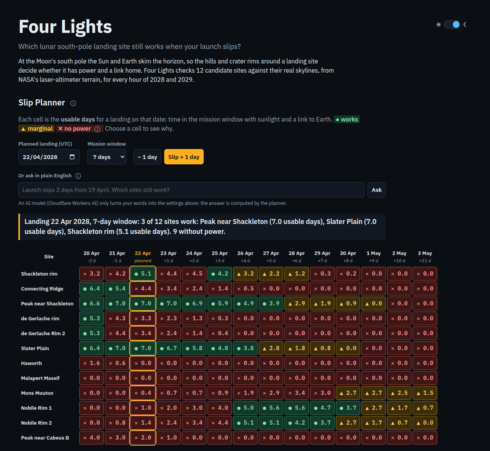

# Four Lights

**Which lunar south-pole landing site still works when your launch slips?** Four Lights shows, for any site and date, whether the Sun and Earth are above that site's real terrain horizon, and turns that into four status lights: **Sun**, **Earth**, **Power** and **Comms**.

Our entry for the [NASA Space Apps Challenge 2026](https://www.spaceappschallenge.org/), challenge [#11 Lunar Landing Site Navigator](https://www.spaceappschallenge.org/2026/challenges/lunar-landing-site-navigator/).

**Live demo:** _URL added on Sunday evening_


_Screenshot added once the demo works._

## What it does
- **Sun-Path Chart:** stand at a site and look around: a 360° skyline from NASA's LOLA terrain, with the Sun's and Earth's paths traced over it and a time slider.
- **Slip Planner:** sites × landing dates, each cell showing **usable days** (hours with the Sun up and Earth in view, over the mission window). Slip the date and see which sites still work.
- 12 curated sites: the six NASA PGDA 5 m sites and six more of NASA's Artemis candidate regions.

## Run it locally
Needs Node 22+, Python 3.12+, [uv](https://docs.astral.sh/uv/) and ruff.
```sh
npm install          # also switches on the repo's git hooks
npm run build        # builds web/ into web/dist
npx wrangler dev     # http://localhost:8787  (page + /api/health)
npm run check        # formatting, lint, type check, ruff
```

## Deploy
```sh
git pull --rebase && npm run check && npm run build && npx wrangler deploy
```
The Cloudflare `account_id` is pinned in `wrangler.jsonc`.

## The data pipeline
`pipeline/` downloads the raw NASA files into `data/raw/` (gitignored), computes a horizon profile for each site (720 sectors of 0.5°, from 5 m terrain out to hundreds of km, in 3D Moon-fixed geometry), pulls hourly Sun and Earth positions from JPL Horizons, and writes small JSON files to `web/public/data/`. The browser computes the four lights from those. Every run is logged in [`stages/01_data/output/data-manifest.md`](stages/01_data/output/data-manifest.md); the data contract is in [`_shared/stack.md`](_shared/stack.md).

## Data sources and credits
- **LOLA south-pole elevation models** (NASA GSFC PGDA and PDS): 5 m site DEMs and 87°S mosaic, https://pgda.gsfc.nasa.gov/products/78 , https://pgda.gsfc.nasa.gov/products/81 ; polar gridded DEMs, https://imbrium.mit.edu/DATA/LOLA_GDR/POLAR/ . Barker et al. (2021), PSS 203, 105119. NASA open data.
- **JPL Horizons** (NASA JPL Solar System Dynamics): Sun and Earth positions from each site, https://ssd.jpl.nasa.gov/horizons/ . NASA open data.
- **NAIF SPICE kernels** (NASA JPL): DE440s, Moon frames, DSN stations, https://naif.jpl.nasa.gov/ . NASA open data.
- **Artemis candidate regions** (USGS, for NASA): LGRS navigational grids, https://doi.org/10.5066/P1MEQ6UK . Public domain.
- Validation: Barker et al. 2021, Mazarico et al. 2011, LOLA and LROC polar illumination maps (`_shared/validation.md`).
Full cards: [`_datasets/`](_datasets/_index.md).

## Licence
Code: [Apache-2.0](LICENSE). Docs, images and the published data files: [CC BY 4.0](LICENSE-docs.md). NASA's source data stays NASA's (credited above); third-party packages keep their own licences.

## Team
Steve Dalton and Matt Paine (team "Make it So", Gold Coast).

## How we built it
The repo is laid out so a coding agent can walk it: numbered stages (`stages/`), each with a `CONTEXT.md` contract and an `output/` folder, shared facts in `_shared/`, one card per dataset in `_datasets/`, and code in plain folders (`pipeline/`, `api/`, `web/`).

The plan, data contract and build prompts were written before the start, and raw NASA files were mirrored unmodified as an outage fallback; all code and data processing happened after 09:00 Sat 14 Nov.

We used AI coding tools (Claude) to help write the code, tests and data pipeline; the idea, the design decisions and the checking of results are ours.
